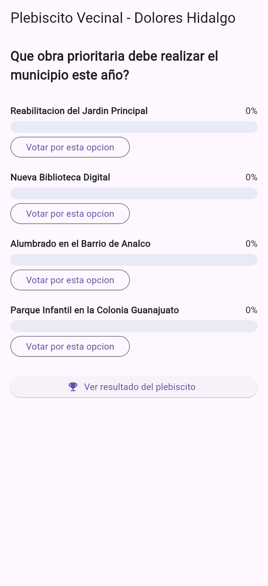
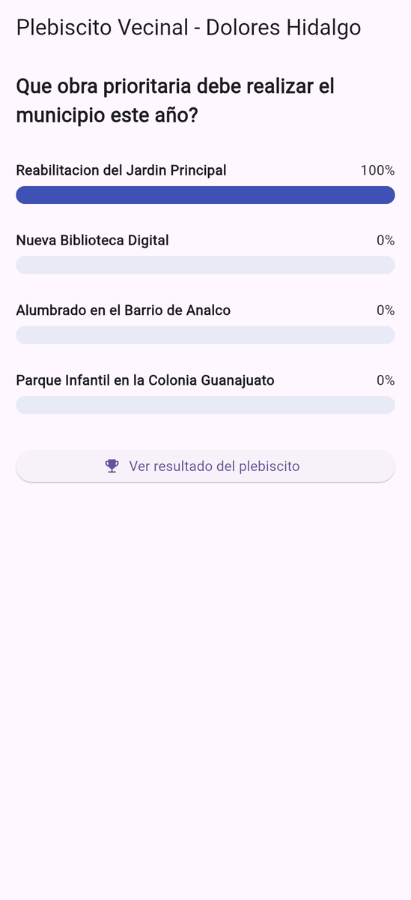
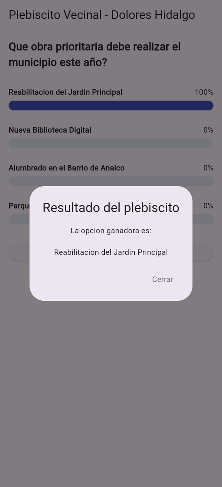
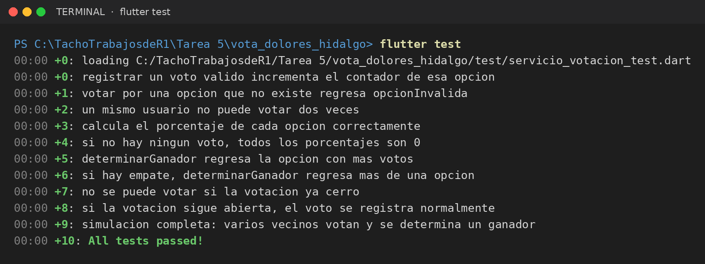

# Vota Dolores Hidalgo · Plebiscito vecinal

App en **Flutter** para un plebiscito vecinal de Dolores Hidalgo: el ciudadano vota por la obra prioritaria del municipio, ve el porcentaje de cada opción y consulta la opción ganadora. La lógica de votación se desarrolló con **TDD** (pruebas primero).

| | |
|---|---|
| **Alumno** | Cristopher Gerardo Villanueva Ramírez |
| **Materia** | Desarrollo de Aplicaciones Móviles |
| **Tarea** | 5 · Desarrollo guiado por pruebas (TDD) |

## Capturas de pantalla

<table>
  <tr><td align="center"><br><sub>Pantalla de votación</sub></td><td align="center"><br><sub>Voto registrado (porcentajes)</sub></td><td align="center"><br><sub>Resultado del plebiscito</sub></td></tr>
</table>

## Reglas de negocio (`ServicioVotacion`)

- Un voto válido suma 1 a la opción elegida.
- Votar por una opción inexistente regresa `opcionInvalida`.
- Un mismo usuario **no puede votar dos veces** (`usuarioYaVoto`).
- Después de la fecha de cierre no se aceptan votos (`votacionCerrada`).
- Los resultados se muestran en porcentaje y, si hay empate, se listan todas las opciones ganadoras.

## Estructura

```
lib/
├── main.dart
├── modelos/        # Votacion, OpcionVotacion, ResultadoOpcion
├── logica/         # ServicioVotacion, ResultadoVoto
└── presentacion/   # VotacionScreen
test/
└── servicio_votacion_test.dart
```

## Pruebas (`flutter test`)

Resultado de correr `flutter test`: **10 pruebas pasan** (*All tests passed!*). Las pruebas están en [`test/servicio_votacion_test.dart`](test/servicio_votacion_test.dart).



## Cómo ejecutar

```bash
flutter pub get
flutter test     # corre las pruebas unitarias
flutter run
```
